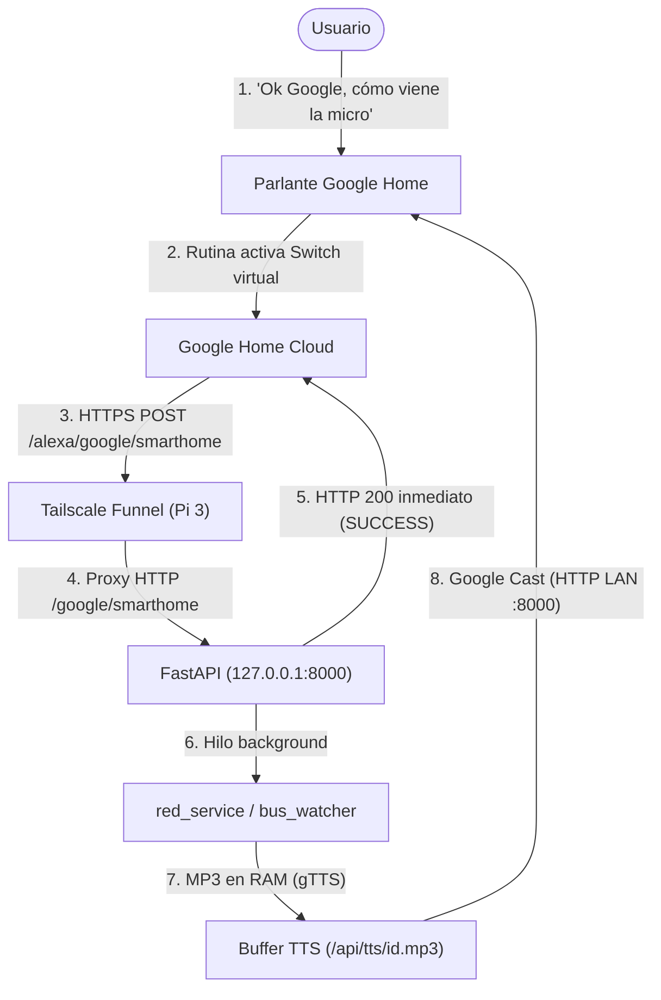

# Especificación de Diseño: Integración Google Home (Smart Home Cloud-to-Cloud + Google Cast TTS)

## 1. Resumen Ejecutivo y Alcance

### 1.1. Objetivo
Incorporar soporte para **Google Home** en el servidor actual de Red Movilidad (`alexa-red.service` en Raspberry Pi 3), manteniendo exactamente la lógica de negocio existente (`config.py`, `src/red_service.py`, `src/bus_watcher.py`) y dirigiendo las respuestas habladas **exclusivamente al parlante Google Home** mediante Google Cast en la red local, sin interrumpir otros dispositivos Cast del hogar (como Android TV).

### 1.2. Alcance Funcional (v1)
Se implementan las acciones equivalentes de uso diario compatibles con invocación nativa por voz en Google Home (vía **Rutinas** en la app Google Home):
1. **Consultar Saldo Bip!** del perfil principal (`user1` / `resolve_user()`).
2. **Consultar Llegada de Micro Habitual** (predictivo dual ida/vuelta usando `red_service.format_dual_prediction_speech`).
3. **Comando Combinado «¿Alcanzo a salir?»** (micro + saldo Bip usando `red_service.format_travel_summary_speech`).
4. **Modo Vigilante (`ON` / `OFF`)**:
   - Activar seguimiento continuo en segundo plano del servicio y paradero habitual en `bus_watcher.py` con aviso hablado automático al cumplirse el umbral (`GOOGLE_WATCH_THRESHOLD_MINUTES`, por defecto `5` minutos).
   - Cancelar la vigilancia activa por voz.

### 1.3. Fuera de Alcance (y Restricción de Plataforma)
Google cerró **Conversational Actions (Dialogflow)** para Google Assistant el 13 de junio de 2023 y deshabilitó los parámetros dinámicos de voz en IFTTT. Por este motivo, no es posible capturar parámetros arbitrarios por dictado libre (como rutas puerta a puerta con calles variables o líneas arbitrarias dictadas al vuelo) en una integración Cloud-to-Cloud gratuita. Esas consultas dinámicas siguen disponibles mediante Alexa y endpoints `/api/...`.

---

## 2. Arquitectura General y Flujo de Datos

### 2.1. Diagrama de Flujo

### 2.2. Enrutamiento Tailscale Existente
Actualmente Tailscale Funnel en la Raspberry Pi 3 expone:
- `https://nowis.tail7d0b63.ts.net/` -> `http://127.0.0.1:3000` (Scrypted, sin cambios).
- `https://nowis.tail7d0b63.ts.net/alexa` -> `http://127.0.0.1:8000` (elimina el prefijo `/alexa` al reenviar).

Por lo tanto, FastAPI registra las rutas directamente bajo `/google/...`, quedando accesibles públicamente sin modificar la configuración de Tailscale:
- **Authorization URL:** `https://nowis.tail7d0b63.ts.net/alexa/google/oauth/auth`
- **Token URL:** `https://nowis.tail7d0b63.ts.net/alexa/google/oauth/token`
- **Fulfillment URL:** `https://nowis.tail7d0b63.ts.net/alexa/google/smarthome`

### 2.3. Dispositivos Virtuales Smart Home (`SWITCH`)
Se exponen **4 dispositivos** de tipo `action.devices.types.SWITCH` con el trait `action.devices.traits.OnOff` (en lugar de `SCENE`), porque `SWITCH` es seleccionable de forma confiable en las Rutinas móviles (*Ajustar dispositivos de la casa*), funciona en Google Home Script Editor y permite estado real encendido/apagado para el Modo Vigilante. Todos usan `agentUserId = "google-home-user1"`.

| ID de Dispositivo | Nombre por Defecto | Comportamiento `EXECUTE` (`on=True`) | Comportamiento `EXECUTE` (`on=False`) | Estado en `QUERY` |
| :--- | :--- | :--- | :--- | :--- |
| `red_saldo_bip` | `Saldo Bip` | Consulta saldo Bip de `user1` y locuta resultado vía Cast. | No-op (responde `SUCCESS`). | Siempre `on: False` (disparador reutilizable). |
| `red_micro_habitual` | `Micro habitual` | Consulta predictivo dual ida/vuelta de `user1` y locuta vía Cast. | No-op (responde `SUCCESS`). | Siempre `on: False` (disparador reutilizable). |
| `red_alcanzo_salir` | `Alcanzo a salir` | Consulta resumen de viaje (`format_travel_summary_speech`) y locuta vía Cast. | No-op (responde `SUCCESS`). | Siempre `on: False` (disparador reutilizable). |
| `red_vigilante` | `Modo vigilante` | Comprueba si ya viene cerca; si no, inicia `watcher_manager.start_watch(..., notify_channel="google_cast")` y locuta confirmación. | Llama `watcher_manager.cancel_watch("google_home")` y locuta confirmación o aviso si no había vigilancia activa. | Real: `watcher_manager.has_active_job("google_home")`. |

En la respuesta HTTP de `EXECUTE`:
- Para los 3 disparadores momentáneos (`red_saldo_bip`, `red_micro_habitual`, `red_alcanzo_salir`), `states` siempre devuelve `{"on": False, "online": True}` para evitar que el interruptor quede trabado visualmente en ON en la app Google Home.
- Para `red_vigilante`, `states` devuelve `{"on": requested_on, "online": True}` tras aceptar la orden y `QUERY` refleja `watcher_manager.has_active_job("google_home")`.

### 2.4. Respuesta Inmediata y Ejecución Asíncrona
Google Smart Home exige que el webhook `EXECUTE` responda dentro de ~2–3 segundos. Consultar las APIs externas de Red Movilidad, generar el audio MP3 con `gTTS` y establecer la sesión Google Cast tarda típicamente 1.5–4 segundos. Para evitar timeouts y mensajes de error de Google Home (*"no se pudo conectar"*):
- `POST /google/smarthome` valida la petición, despacha la tarea en un hilo `threading.Thread(..., daemon=True)` y retorna HTTP 200 `SUCCESS` de inmediato (< 20 ms).
- El hilo en segundo plano ejecuta la consulta, sintetiza el MP3 en RAM y lo reproduce por Google Cast.

---

## 3. Diseño Detallado de Componentes

### 3.1. Salida de Voz Local (`src/google_cast_service.py`)

Responsable de convertir texto en español a audio MP3 en memoria y reproducirlo únicamente en el parlante configurado.

- **Buffer circular en RAM (cero escritura en microSD):**
  - Estructura `OrderedDict[str, bytes]` protegida por `threading.Lock`, con capacidad máxima `MAX_TTS_CLIPS = 10` (evicción FIFO del clip más antiguo).
  - `create_tts_clip(text: str) -> str`: normaliza códigos de paradero Santiago (regex `\b(P[A-J]\d{1,4})\b` usando `clean_spoken_stop_code` para pronunciar `"P D 289"` en vez de `"PD289"`), genera audio con `gTTS(text=normalized, lang="es")`, lo escribe en un `io.BytesIO`, almacena los bytes bajo `clip_id = uuid.uuid4().hex` y retorna `clip_id`.
  - `get_tts_clip(clip_id: str) -> Optional[bytes]`: obtiene los bytes del MP3 para ser servidos por HTTP en `GET /api/tts/{clip_id}.mp3`.
- **Resolución de IP local (`get_local_ip() -> str`):**
  - Si `config.LOCAL_SERVER_IP` tiene valor no vacío, la retorna directamente.
  - En caso contrario, detecta la interfaz LAN local mediante socket UDP hacia `8.8.8.8:80` (`connect` sin enviar paquetes), con fallback a `"127.0.0.1"`.
- **Descubrimiento y filtrado estricto de dispositivo Cast:**
  - `list_cast_devices(timeout: float = 5.0) -> List[Dict[str, Any]]`: descubre dispositivos en el Wi-Fi con `pychromecast.get_chromecasts(timeout=timeout)`, extrae `name` (`friendly_name`), `model_name`, `cast_type`, `uuid`, `host`, `port`, y cierra obligatoriamente el navegador Zeroconf con `pychromecast.discovery.stop_discovery(browser)` en bloque `finally`.
  - `speak_on_home(text: str, device_name: Optional[str] = None) -> bool`:
    - Serializado mediante `_speak_lock = threading.Lock()` para que dos rutinas consecutivas no se pisen el audio.
    - Toma `target_name = (device_name or config.GOOGLE_CAST_DEVICE).strip()`. Si está vacío, registra error en `logger` y retorna `False` (nunca selecciona un dispositivo arbitrario para evitar reproducir audio en la Android TV).
    - Llama `pychromecast.get_listed_chromecasts(friendly_names=[target_name], discovery_timeout=5.0)`. Si `casts` está vacío, registra advertencia con el nombre buscado y retorna `False`.
    - Selecciona únicamente la coincidencia exacta con `target_name`, ejecuta `cast.wait(timeout=5.0)`, genera `clip_id = create_tts_clip(text)` y construye `media_url = f"http://{get_local_ip()}:{config.PORT}/api/tts/{clip_id}.mp3"`.
    - Reproduce con `cast.media_controller.play_media(media_url, "audio/mpeg")` y `cast.media_controller.block_until_active(timeout=5.0)`.
    - En `finally` cierra `cast.disconnect(timeout=2.0)` y llama `pychromecast.discovery.stop_discovery(browser)` para no fugar hilos Zeroconf ni sockets en la Pi 3.
  - Nota operativa: si el parlante está reproduciendo música en ese momento, Google Cast pausará o reemplazará esa reproducción para entregar el aviso de voz.

### 3.2. Protocolo Google Smart Home y OAuth2 Stateless (`src/google_smarthome.py`)

Implementado como `APIRouter` de FastAPI con cuatro rutas explícitas y firma criptográfica estándar (`hmac` + `hashlib` + `base64`).

- **Tokens y códigos stateless (HMAC-SHA256):**
  - El formato es `<payload_b64url>.<sig_b64url>` firmado con `GOOGLE_OAUTH_CLIENT_SECRET`.
  - Esto evita almacenar estado en disco o base de datos: los `refresh_token` siguen siendo válidos tras reinicios del servicio o de la Raspberry Pi 3.
  - Tipos de token validados en el payload (`kind`):
    - `"code"`: TTL `300` segundos, vincula `client_id` y `redirect_uri`.
    - `"access"`: TTL `3600` segundos.
    - `"refresh"`: TTL `0` (sin expiración fija mientras coincida la firma con `GOOGLE_OAUTH_CLIENT_SECRET`; configurable pasando el estado de consentimiento OAuth de Google Cloud a *Production* personal para evitar revocaciones cada 7 días).
- **Flujo OAuth2 (`Authorization Code`):**
  - `redirect_uri` permitidas: únicamente prefijos `https://oauth-redirect.googleusercontent.com/r/` o `https://oauth-redirect-sandbox.googleusercontent.com/r/`.
  - `GET /google/oauth/auth`: valida `response_type == "code"`, `client_id` contra `config.GOOGLE_OAUTH_CLIENT_ID` y `redirect_uri`; si falta configuración (`GOOGLE_OAUTH_PIN`, `CLIENT_ID` o `CLIENT_SECRET` vacíos), responde HTTP 503 con error seguro en log. Caso válido: renderiza formulario HTML mínimo pidiendo PIN personal y preservando `client_id`, `redirect_uri` y `state` en campos ocultos.
  - `POST /google/oauth/auth`: valida `client_id`, `redirect_uri` y compara el PIN enviado con `config.GOOGLE_OAUTH_PIN` mediante `hmac.compare_digest`. Si coincide, genera `code` firmado y redirige (`302`) a `redirect_uri` agregando `code` y `state` (usando `urllib.parse`); si no coincide, re-renderiza el formulario con mensaje de error y HTTP 401.
  - `POST /google/oauth/token`: lee formulario `application/x-www-form-urlencoded` y acepta credenciales de cliente tanto en el cuerpo del formulario (`client_secret_post`) como vía cabecera HTTP `Authorization: Basic ...` (`client_secret_basic`), verificando `client_id` y `client_secret` con `hmac.compare_digest` (rechazando si `GOOGLE_OAUTH_CLIENT_SECRET` está vacío):
    - `grant_type == "authorization_code"`: verifica `code` (`kind="code"`, no expirado, mismo `client_id` y `redirect_uri`) y devuelve `token_type="Bearer"`, `access_token`, `refresh_token`, `expires_in=3600`.
    - `grant_type == "refresh_token"`: verifica `refresh_token` (`kind="refresh"`, mismo `client_id`) y devuelve `token_type="Bearer"`, `access_token`, `expires_in=3600`.
    - Cualquier error de credenciales o token retorna HTTP 400 con formato OAuth2 (`{"error": "invalid_client"}` o `{"error": "invalid_grant"}`).
- **Webhook Smart Home (`POST /google/smarthome`):**
  - Exige cabecera `Authorization: Bearer <token>` válida (`kind="access"`, firma correcta y vigente); si falla, responde HTTP 401.
  - Despacha `request_id = body["requestId"]` y `intent = body["inputs"][0]["intent"]`:
    - `action.devices.SYNC`: devuelve `agentUserId = "google-home-user1"` y las definiciones de los 4 dispositivos `SWITCH`.
    - `action.devices.QUERY`: evalúa los `device.id` solicitados; para `red_vigilante` consulta `watcher_manager.has_active_job("google_home")`, para los 3 disparadores devuelve `on: False`, y para IDs desconocidos reporta `status: "ERROR", errorCode: "deviceNotFound"`.
    - `action.devices.EXECUTE`: valida comandos `action.devices.commands.OnOff`, registra la respuesta `SUCCESS` inmediata y dispara `_execute_device_action(device_id, target_on)` en un hilo `daemon=True` (extraída como función limpia para poder invocarse sincrónicamente en pruebas unitarias sin condiciones de carrera).
    - `action.devices.DISCONNECT`: registra la desvinculación en el log y responde `{}` HTTP 200.

### 3.3. Lógicas de Negocio de `_execute_device_action`

Reutiliza directamente los servicios existentes tomando el perfil principal `user_info = config.resolve_user()` y `user_stops = config.get_user_stops()`:
1. `red_saldo_bip` (`on=True`):
   - `speech = red_service.format_balance_speech(bip_code=user_info["card"], user_name=user_info["name"])`
   - `google_cast_service.speak_on_home(speech)`
2. `red_micro_habitual` (`on=True`):
   - `speech = red_service.format_dual_prediction_speech(linea=user_info["service"], stop_ida=user_stops["ida"], stop_vuelta=user_stops.get("vuelta"), intersection=user_stops.get("intersection"))`
   - `google_cast_service.speak_on_home(speech)`
3. `red_alcanzo_salir` (`on=True`):
   - `stop_code = user_stops["ida"]["code"]`
   - `speech = red_service.format_travel_summary_speech(user_name=user_info["name"], card_number=user_info["card"], stop_code=stop_code, service=user_info["service"])`
   - `google_cast_service.speak_on_home(speech)`
4. `red_vigilante`:
   - Resuelve `clean_linea = config.clean_alphanumeric_code(user_info["service"] or config.DEFAULT_SERVICE)`, `stop_ida = user_stops["ida"]`, `stop_code = stop_ida["code"]`, `corner_name = user_stops.get("intersection") or stop_ida.get("name") or stop_code`, y `threshold = max(1, config.GOOGLE_WATCH_THRESHOLD_MINUTES)`.
   - Si `on=True`:
     - Chequeo preliminar `red_service.get_stop_predictions(stop_code, clean_linea)`: si hay bus con `min_time <= threshold`, habla de inmediato *"Tu micro {clean_linea} ya está muy cerca, a {min_time} minutos de tu esquina en {corner_name}. Es momento de salir ahora mismo."* sin crear job.
     - Si está lejos (o sin buses inmediatos / error transitorio en chequeo inicial), inicia `watcher_manager.start_watch(user_id="google_home", linea=clean_linea, stop_code=stop_code, corner_name=corner_name, threshold_minutes=threshold, api_endpoint="", api_access_token="", notify_channel="google_cast")` y habla confirmación: *"Perfecto, estaré vigilando la micro {clean_linea} en tu esquina de {corner_name}. Te avisaré apenas esté a {threshold} minutos."*
   - Si `on=False`:
     - `cancelled = watcher_manager.cancel_watch("google_home")`
     - Si `cancelled`: habla *"Listo, cancelé la vigilancia de tu micro."*
     - Si no había vigilancia activa: habla *"No hay ninguna vigilancia de micro activa en este momento."*

### 3.4. Extensión Multi-Canal en `src/bus_watcher.py`

Cambio mínimo y 100% retrocompatible con Alexa:
- `WatcherJob`: añadir campo opcional `notify_channel: str = "alexa"`.
- `BusWatcherManager.start_watch(...)`: añadir parámetro opcional `notify_channel: str = "alexa"`.
- En `_worker_loop`: al cumplirse `min_time <= job.threshold_minutes`:
  - Si `job.notify_channel == "google_cast"`: invocar `google_cast_service.speak_on_home(spoken_text)` dentro de `try/except` registrando resultado en `logger`.
  - Caso contrario (`"alexa"`): mantener sin cambios `reminders_service.create_spoken_reminder(...)`.

### 3.5. Integración en Servidor y Configuración (`src/local_server.py`, `config.py`, `requirements.txt`)

- `config.py` (y `.env.example`):
  - `GOOGLE_OAUTH_CLIENT_ID` (str, default `""`)
  - `GOOGLE_OAUTH_CLIENT_SECRET` (str, default `""`)
  - `GOOGLE_OAUTH_PIN` (str, default `""`)
  - `GOOGLE_CAST_DEVICE` (str, default `""`)
  - `LOCAL_SERVER_IP` (str, default `""`)
  - `GOOGLE_WATCH_THRESHOLD_MINUTES` (int, default `5`)
- `src/local_server.py`:
  - Montar `app.include_router(google_smarthome.router)`.
  - `GET /api/tts/{clip_id}.mp3`: entrega bytes MP3 desde RAM con `media_type="audio/mpeg"`, o HTTP 404 si no existe/fue evictado.
  - `GET /api/cast/devices`: ejecuta `google_cast_service.list_cast_devices()` y retorna JSON `{"devices": [...]}` para facilitar la identificación del parlante frente a la Android TV.
- `requirements.txt`: agregar `pychromecast` y `gTTS`.

---

## 4. Manejo de Errores y Logging Estructurado

- Se utiliza `logging.getLogger(__name__)` en `src/google_cast_service.py` y `src/google_smarthome.py` para emitir logs limpios hacia `journald` (`alexa-red.service`).
- Cualquier excepción en `_execute_device_action` (fallo de red hacia `api.xor.cl`, error de `gTTS` o timeout mDNS de Cast) es capturada y logueada con `exc_info=True` sin afectar la disponibilidad de Alexa ni los demás endpoints.
- Si falla la consulta a Red Movilidad pero el parlante está accesible, `red_service` ya retorna mensajes hablables de fallback que se envían por Cast salvo fallo específico de `speak_on_home`.

---

## 5. Estrategia de Pruebas y Verificación

1. **Pruebas unitarias nuevas y extendidas (`pytest`):**
   - `tests/test_google_cast_service.py`:
     - Buffer circular de máx. 10 clips (verificando evicción del más antiguo).
     - Normalización de paradero en texto para TTS (`PD289` -> `P D 289`, preservando líneas como `401c`).
     - Selección estricta por `GOOGLE_CAST_DEVICE` (rechazo/fallo limpio si no coincide o si está vacío, nunca eligiendo la Android TV).
     - Limpieza de descubrimiento Zeroconf (`stop_discovery`) incluso cuando falla `play_media` o `wait`.
   - `tests/test_google_smarthome.py`:
     - Flujo completo OAuth2 (GET formulario, PIN correcto/incorrecto, falta de PIN -> 503, intercambio `authorization_code` y `refresh_token`, rechazo de `client_secret` inválido o token manipulado/expirado).
     - Rechazo Bearer inválido en `POST /google/smarthome` (401).
     - Intents `SYNC`, `QUERY` (refleja estado real del vigilante y `False` en los 3 disparadores) y `EXECUTE` para los 4 switches comprobando invocación a `red_service`, `watcher_manager` y `google_cast_service.speak_on_home`.
   - `tests/test_bus_watcher.py`:
     - Caso nuevo validando que `notify_channel="google_cast"` llame a `google_cast_service.speak_on_home` y no a `reminders_service.create_spoken_reminder`.
   - `tests/test_server_endpoints.py`:
     - Cobertura de `GET /api/tts/{clip_id}.mp3` (200 y 404) y `GET /api/cast/devices` (mockeado).
2. **Verificación en vivo en Raspberry Pi 3:**
   - Despliegue del servicio con `pychromecast` y `gTTS`.
   - Ejecución de `GET /api/cast/devices` para confirmar nombres exactos del parlante Google Home y de la Android TV, fijando `GOOGLE_CAST_DEVICE` en `.env`.
   - Prueba real de reproducción hablada únicamente en el parlante Google Home verificando que la Android TV permanezca intacta.
   - Guía paso a paso para configurar Google Cloud OAuth2 (*In Production* personal), proyecto Smart Home Cloud-to-Cloud en Google Home Developer Console, vinculación *"Funciona con Google"* y Rutinas de voz en español en la app Google Home.
